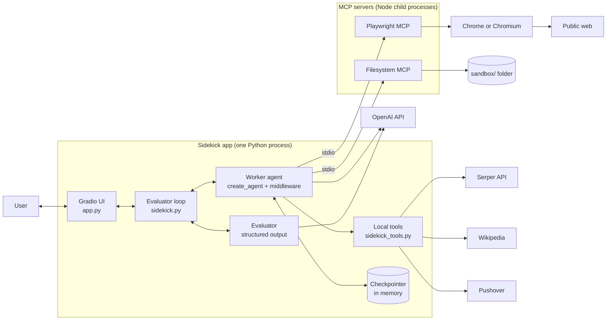
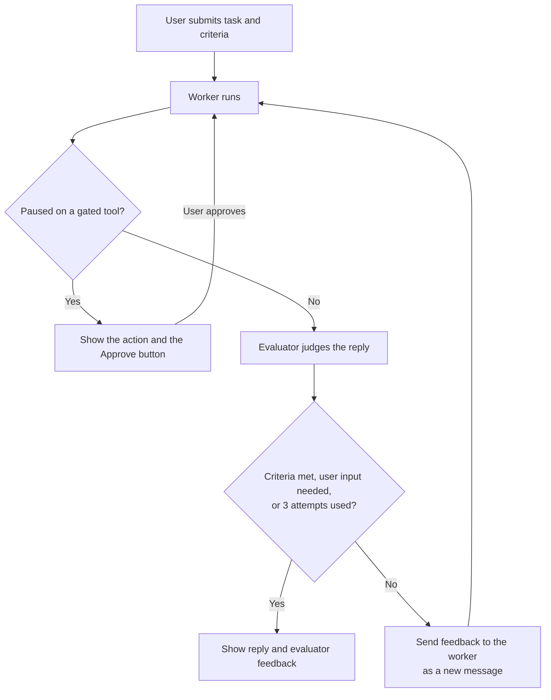

# Sidekick AI Architecture

This document explains how the Sidekick is built and why, what happens to data as it moves through the system, and where the design has known limits. It is for engineers who want to change, operate or review the app. For setup and deployment steps, see the [README](../README.md).

## Summary

The Sidekick takes a task and a definition of success from a user, then works on the task with a real browser and other tools. It has two AI roles:

- A **worker** agent plans and acts.
- An **evaluator** model judges the worker's answer against the user's success criteria, and can send the worker back to try again.

Plain Python controls the loop between them, so the rules for retrying and stopping are ordinary code that can be read and tested. A person approves sensitive actions before they run.

| Decision | Choice |
| --- | --- |
| Agent framework | LangChain `create_agent`, which runs on LangGraph |
| Model | `z-ai/glm-5.3-flash` through OpenRouter for both roles |
| Control flow | A hand-written evaluator loop around the agent |
| Browser and filesystem | MCP servers over stdio, held open in persistent sessions |
| UI | Gradio |
| Agent state | In memory, per browser session |
| Deployment | Natively on a desktop, or as a Docker image locally and on Hugging Face Spaces |

## System overview



| File | Responsibility |
| --- | --- |
| [`app.py`](../app.py) | Gradio UI, per-session lifecycle, login rules, entry point |
| [`sidekick.py`](../sidekick.py) | Worker setup, middleware stack, evaluator, retry loop, pause and resume |
| [`sidekick_tools.py`](../sidekick_tools.py) | Local tools, MCP connection settings, persistent MCP sessions, headless switch |
| [`styles.py`](../styles.py) | Theme and CSS |
| [`package.json`](../package.json) | Pinned MCP server versions |

## The worker

The worker is a single `create_agent` agent. It repeatedly calls the model, runs the tools the model asks for, and stops when the model replies without asking for a tool. Its system prompt describes its tools and when to ask the user for help, and gives it today's date and a shortcut for flight searches.

### Tools

| Tool | Source | Purpose | Needs approval |
| --- | --- | --- | --- |
| `browser_*` | Playwright MCP | Navigate, read and interact with web pages | No |
| Filesystem tools such as `write_file` | Filesystem MCP | Read and write inside `sandbox/` | No |
| `google_serper` | Serper, through LangChain | Web search | No |
| `wikipedia` | Wikipedia, through LangChain | Encyclopedia lookups | No |
| `send_push_notification` | Pushover | Message the user's phone | **Yes** |
| `request_human_help` | Local | Ask the user to log in or solve a captcha in the browser window. Headed mode only. | **Yes** |
| `write_todos` | `TodoListMiddleware` | Maintain the plan shown in the UI | No |

The MCP servers provide most of the tools: 41 of the 44 listed by `sidekick.tools` in headless mode. Every tool definition goes to the model on each call, which adds to the input tokens.

### Middleware

Middleware wraps the worker's model and tool calls. The stack is defined in `Sidekick.setup()`.

| Middleware | Configuration | What it does |
| --- | --- | --- |
| `TolerateToolErrors` (ours) | None | Turns a tool exception into a message to the model, so it can try another approach instead of crashing the run |
| `TodoListMiddleware` | Defaults | Adds `write_todos` and keeps the plan in agent state |
| `PIIMiddleware("email")` | Redacts input | Redacts email addresses in user input before they reach the model |
| `PIIMiddleware("credit_card")` | Redacts input and tool results | Also redacts card numbers in tool results, such as browser pages |
| `ModelCallLimitMiddleware` | `run_limit=30` | Ends a run after 30 model calls |
| `HumanInTheLoopMiddleware` | `send_push_notification`, and `request_human_help` when headed | Pauses the run before these tools execute |

## The evaluator loop

After each worker attempt, the evaluator returns a structured verdict:

| Field | Meaning |
| --- | --- |
| `success_criteria_met` | The answer meets the user's criteria |
| `user_input_needed` | The worker asked a question, needs clarification or seems stuck |
| `feedback` | Brief, concrete notes, shown to the user or passed back to the worker |

The loop in `Sidekick._advance()` acts on that verdict:



**Why the loop is hand-written.** The rules are short enough to read in one function, and the same code handles a first attempt, a retry and a resume after approval. This keeps the evaluator outside the agent, so the worker can't skip or influence the check except through its answer.

**What the evaluator sees.** It receives the task, the criteria, the worker's latest reply, and the names of the tools called. It doesn't see tool arguments or results. It can tell that `write_file` was called, but not what was written, so a confident but wrong answer can pass.

**When attempts run out.** After three attempts the loop returns the last reply with the evaluator's feedback. The user has to read that feedback to learn the criteria were not met, because the UI shows no separate failure state.

## Human approval

Approval uses LangGraph's interrupt mechanism, and works like this:

```mermaid
sequenceDiagram
    actor User
    participant UI as Gradio UI
    participant Loop as Evaluator loop
    participant Worker
    participant Tool as send_push_notification

    User->>UI: Submit task
    UI->>Loop: run_turn()
    Loop->>Worker: Stream the run
    Worker-->>Loop: Interrupt with pending actions
    Loop-->>UI: History, with paused set
    UI-->>User: Show the action and the Approve button
    User->>UI: Approve
    UI->>Loop: resume()
    Loop->>Worker: Command(resume=approve)
    Worker->>Tool: Execute
    Tool-->>Worker: Result
    Worker-->>Loop: Final reply
    Loop-->>UI: Reply and evaluator feedback
```

The paused run is saved by the checkpointer, so nothing is held open while waiting except the MCP sessions. The UI offers approval only. The middleware also supports editing and rejecting an action, but those aren't exposed. To decline, the user has to press Reset, which discards the session's conversation.

## MCP sessions

By default, each MCP tool call could open a new server session, which would lose the browser's state between calls. Instead, `McpSessions` holds one session per server open for the Sidekick's lifetime.

The stdio transport must be opened and closed from the same asyncio task, so one background task owns the sessions. It opens them, waits for a stop signal, then closes them. Stopping shuts down the servers and closes the browser.

The servers are pinned in `package-lock.json` and started with `npx --no-install`, so the app never downloads code at runtime.

## State and data

| State | Where it lives | Lifetime |
| --- | --- | --- |
| Agent messages, plan, paused runs | `InMemorySaver`, keyed by a per-Sidekick thread ID | Until Reset, session expiry or restart |
| Chat history for display | Gradio Chatbot component | Browser session |
| Sidekick instance and MCP sessions | `gr.State`, one per browser session | Until Reset, or until the tab is closed or refreshed |
| Browser window and profile | In memory (`--isolated`) | Until the task ends; kept open while the Sidekick waits on the user |
| Files | `sandbox/` | Disk: permanent natively, mounted from the host in Compose, wiped on restart on Spaces |

The plan panel updates from a one-second timer that reads `sidekick.todos`. The timer is the panel's only writer, because Gradio would otherwise lock the panel while the long-running task event is in progress.

### Where data goes

| Destination | What is sent |
| --- | --- |
| OpenAI | Tasks and success criteria, conversation history, tool results including web page content, and tool definitions |
| Serper | Search queries |
| Wikipedia | Lookup queries |
| Pushover | Notification text, after approval |
| Websites | Whatever the agent's browser requests or submits |

## Security

### Threats and controls

| Threat | Current control | Remaining gap |
| --- | --- | --- |
| A stranger uses the app and spends the API keys | A login is required on Spaces; Compose publishes only to localhost | Gradio login is a single shared account, with no rate limit or per-user budget |
| Runaway agent costs | 30 model calls per run, three attempts per turn | No overall limit on spend |
| Secrets leak through the repo or image | `.env` is excluded by `.gitignore` and `.dockerignore`; Spaces use secrets | Developers must keep keys out of tracked files |
| Secrets leak to MCP servers | Child processes inherit only a small set of variables such as `PATH`, not API keys | None known |
| The agent reads or writes outside its folder | The filesystem server is limited to `sandbox/`, and `--allow-unrestricted-file-access` isn't set | None known |
| Sensitive data reaches the model | Redacts emails in input and card numbers in input and tool results | Pattern matching only: names, addresses, passwords and other personal data aren't covered |

### Prompt injection is the main open risk

The worker reads untrusted web pages and acts on them with the same model context. A malicious page could tell it to write misleading files, visit a URL containing data from the conversation, or draft a misleading notification. Approval covers push notifications only. Browser actions, including form submissions, run without approval.

Until this is addressed:

- Don't sign in to accounts holding valuable data or payment methods in the Sidekick's browser.
- Read the arguments of an approval request before approving it.
- Treat the agent's output as unverified, especially on pages you don't trust.

### Container isolation

Headless mode runs Chromium with `--no-sandbox`, because containers generally don't allow the kernel features its sandbox needs. A browser exploit would then be contained by the container alone. The container runs as a non-root user and holds the API keys in its environment, and its outbound network access isn't restricted. Keep the image updated, and don't run it with extra privileges or on a network with sensitive internal services.

## Deployment modes

| | Native | Docker Compose | Hugging Face Space |
| --- | --- | --- | --- |
| Browser | Installed Chrome, visible | Bundled Chromium, headless | Bundled Chromium, headless |
| `request_human_help` | Available | Removed | Removed |
| Login | Optional | Optional | Required |
| Reachable from | This machine by default | This machine | The internet, or Space members if private |
| Files | Local `sandbox/` | `./sandbox` mounted from the host | Temporary, with no download link |
| Secrets | `.env` | `.env`, passed as container environment | Space secrets |

A single setting, `SIDEKICK_HEADLESS`, selects the mode. It changes the browser flags, the tool list, the approval list and the system prompt together, so the agent is never told about a browser the user can't reach. The Docker image sets it.

**Why a Docker Space.** The app needs Node and Chromium with their system libraries alongside Python, which the Dockerfile provides explicitly. The same image also runs locally, so local Docker runs exercise what a Space will run.

## Scaling and reliability

The design suits one person. Scaling it up runs into these limits:

- **Memory:** each open browser session starts its own MCP servers and browser.
- **Concurrency:** Gradio's default queue runs one event at a time per handler, so one user's long task can make others wait.
- **Shared files:** all sessions use the same `sandbox/`, so users can see and overwrite each other's files.
- **Restarts:** agent state is in memory, so a restart loses conversations and paused runs.
- **Worst-case cost per turn:** three attempts at 30 calls each is about 90 worker calls, plus the evaluator. Approvals can add more, and each call carries all the tool definitions and growing history.

## Observability and testing

The app has no tracing, metrics or cost tracking. Evidence of a run is limited to the chat, the plan panel and the container logs, which makes a bad agent decision hard to diagnose after the fact.

The unit tests in [`tests/test_config.py`](../tests/test_config.py) cover deployment settings, login rules and UI helpers, and make no API calls. There's no automated evaluation of agent quality or CI pipeline, so model or prompt changes have to be checked by hand.

## Known limitations and next steps

In rough priority order:

1. **Gate consequential browser actions** behind approval, to reduce the prompt injection risk.
2. **Add tracing and cost tracking**, such as LangSmith or Langfuse, including a spend limit per run.
3. **Give the evaluator stronger evidence**, such as tool arguments, results and sandbox file contents.
4. **Add a file download panel**, so files are reachable on Spaces.
5. **Add reject and edit** to the approval UI, so declining doesn't require a Reset.
6. **Show a clear failure state** when attempts run out.
7. **Use a sandbox folder per session**, if more than one person will use a deployment.
8. **Add CI and an evaluation suite** with a fixed set of tasks, to catch regressions from model and prompt changes.
9. **Replace `langchain-community`**, which is being retired, with standalone packages for search and Wikipedia.
